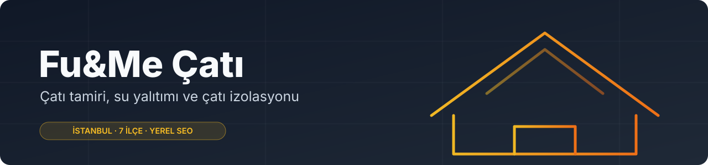

<p align="center">
  
</p>

<p align="center">
  
  
  
  
  <a href="https://fumecati.com"></a>
</p>

---

## 🏠 Proje

**Fu&Me Çatı**, Beylikdüzü merkezli çatı tamiri, su yalıtımı ve çatı izolasyonu firmasının **yerel SEO odaklı** web sitesidir. Amaç, "ilçe + hizmet" aramalarında görünür olmak ve ziyaretçiyi ücretsiz keşif talebine yönlendirmektir.

🌐 **Canlı site:** [fumecati.com](https://fumecati.com)

## 🧭 Site yapısı

| Bölüm | Sayfalar |
|---|---|
| **Hizmetler** | Çatı tamiri, çatı izolasyonu, su yalıtımı, ısı yalıtımı, kiremit aktarma, çatı akıntısı tamiri, yeni çatı yapımı, fiyat rehberi |
| **İlçe sayfaları** | Beylikdüzü, Esenyurt, Avcılar, Büyükçekmece, Küçükçekmece, Silivri, Arnavutköy |
| **İçerik** | Blog (16 yazı), sıkça sorulan sorular |
| **İletişim** | İletişim sayfası, 404 |

## 🔎 SEO

- Her ilçe ve hizmet için ayrı, özgün sayfa ve başlık
- Canonical, Open Graph, `robots.txt`, `sitemap.xml` (37 adres)
- Eski ve sık yazılan adresler için 301 yönlendirmeleri (`_redirects`)
- Boyutlandırılmış `webp` görseller, mobil öncelikli yerleşim

## ⚡ Teknik

Saf **HTML, CSS ve JavaScript**. Derleme ve bağımlılık yok; klasör olduğu gibi yayınlanır.

```
index.html, hizmetler.html, *-cati-tamiri.html   sayfalar
blog/, blog.html                                  blog
assets/                                           site.css, görseller
_redirects, robots.txt, sitemap.xml               yönlendirme ve SEO
```

Yerelde açmak için: `python3 -m http.server` ve ardından <http://localhost:8000>.

---

<p align="center"><sub>Fu&amp;Me Çatı · İstanbul</sub></p>
